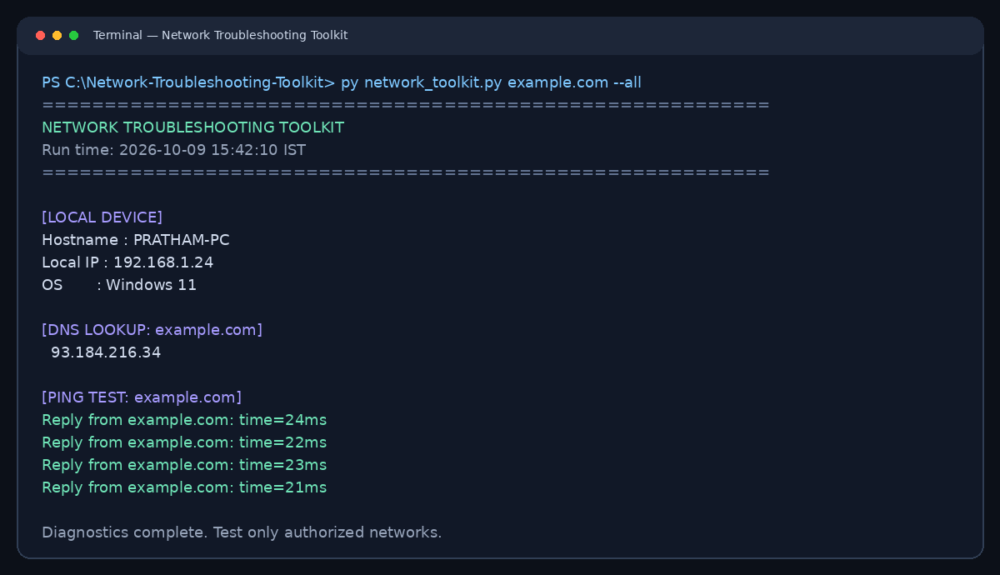

# Network Troubleshooting Toolkit

A Python CLI utility for DNS resolution, ping diagnostics, and local device information. Portfolio project for IT Engineer, IT Support Engineer, and Technical Support Engineer roles.

## Features
- Hostname, OS, and best-effort local IP information
- DNS lookup for hostnames
- OS-aware ping for Windows, macOS, and Linux
- Bounded ping count and timeout values
- Readable error handling for DNS failures, missing ping command, and timeouts
- Python standard library only

## Screenshot


This is a terminal-style preview image. Actual output varies by device and network.

## Requirements
Python 3.10 or later, a terminal, and the system `ping` command for ping tests.

## Usage
No package installation is required:
```bash
python network_toolkit.py --help
python network_toolkit.py --info
python network_toolkit.py example.com --dns
python network_toolkit.py example.com --ping
python network_toolkit.py example.com --all
python network_toolkit.py 1.1.1.1 --ping
```
On Windows, use `py` instead of `python` if needed:
```powershell
py network_toolkit.py example.com --all
```

## Troubleshooting
- Ping failure does not prove a host is offline; firewalls can block ICMP.
- DNS tests require a functioning resolver and network connection.
- Some Linux distributions may not have `ping` installed by default.
- Devices with VPNs or multiple adapters may report a different active IP address.

## Safety
Use this tool only on systems and networks you own or are authorized to troubleshoot. It performs DNS lookups and a limited number of ping requests; it does not scan ports.

## Resume bullets
- Developed a Python diagnostic toolkit for DNS resolution, host reachability, and local network information.
- Implemented OS-aware ping execution, bounded timeouts, and error handling for common connectivity issues.
- Applied networking fundamentals to create a repeatable workflow for initial IT troubleshooting.
